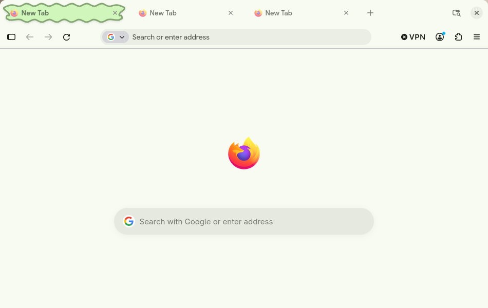

# MaterialFox — Material You Green for Firefox

A green Material You theme for Firefox with a leaf-shaped active tab, a styled new tab page, and smooth tab animations.

[Русская версия](README_RUS.md)

## Features

- Material You green color palette
- Leaf-shaped active tab with a mirrored, symmetric outline
- Smooth tab switching: the leaf crossfades and scales into place
- Selected tab expands to 250px while the others stay compact
- Hover, press, favicon, close-button, and new-tab micro-interactions
- Styled `about:newtab` and `about:home` pages
- Pinned tabs and `prefers-reduced-motion` support

## Installation

1. Open `about:profiles` in Firefox.
2. Find the **Root Directory** of the profile you use.
3. Create a folder named `chrome` inside that root directory if it does not exist.
4. Copy these files into `chrome/`:
   - `userChrome.css`
   - `userContent.css`
   - `leaf-tab.svg`
5. Open `about:config`, accept the warning, and set:
   - `toolkit.legacyUserProfileCustomizations.stylesheets` to `true`
6. Restart Firefox.

The `leaf-tab.svg` file must stay next to `userChrome.css`, because the stylesheet references it as `url("leaf-tab.svg")`.

## Notes

- This theme uses `userChrome.css`, which is not officially supported by Mozilla. A future Firefox update may require selector fixes.
- Tested with Firefox 158.0.1 on Linux. The same CSS should work on Windows and macOS; only the profile path is different.
- Back up your profile before installing custom CSS.
- The new tab page styling in `userContent.css` applies to `about:newtab` and `about:home`.

## Customization

The main palette is defined as `--md-*` variables at the top of `userChrome.css`. The leaf fill and stroke colors are in `leaf-tab.svg`.

## License

MIT — see [LICENSE](LICENSE).
